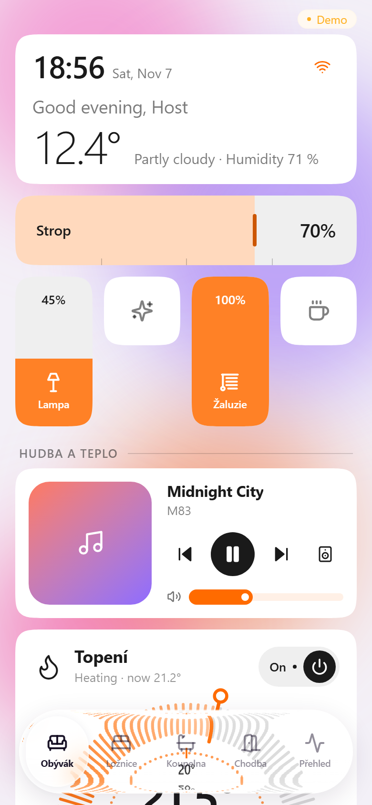
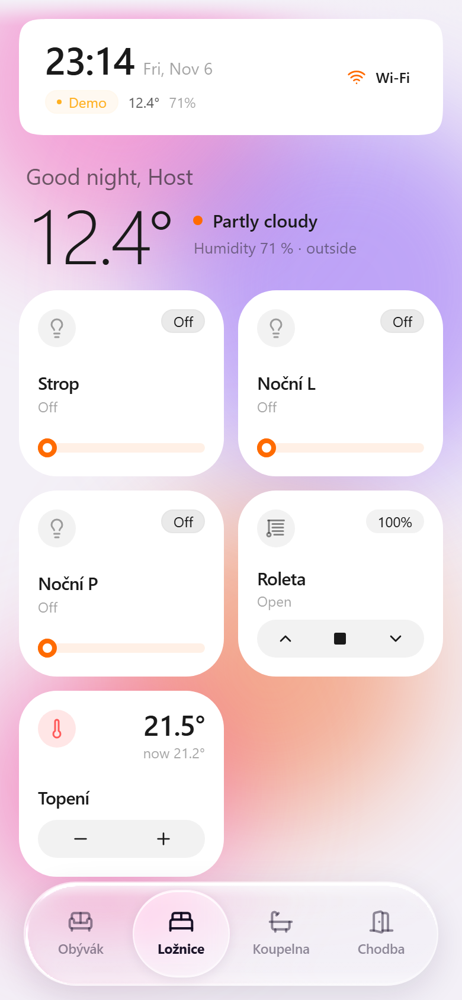
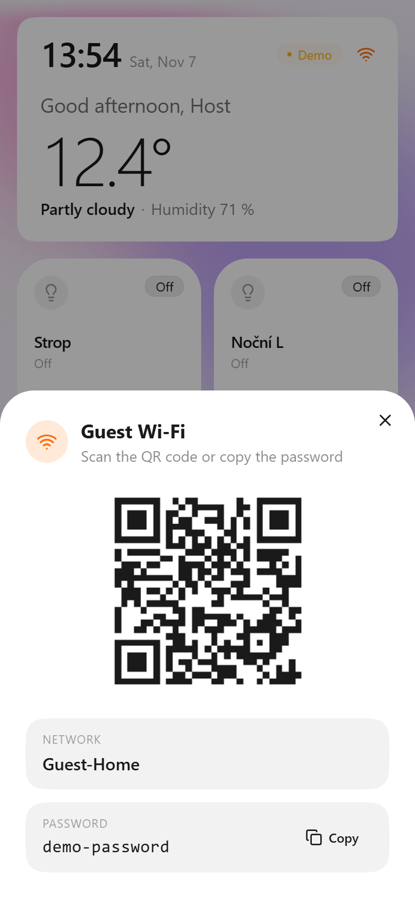
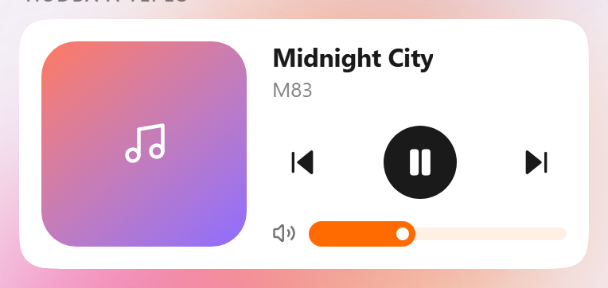
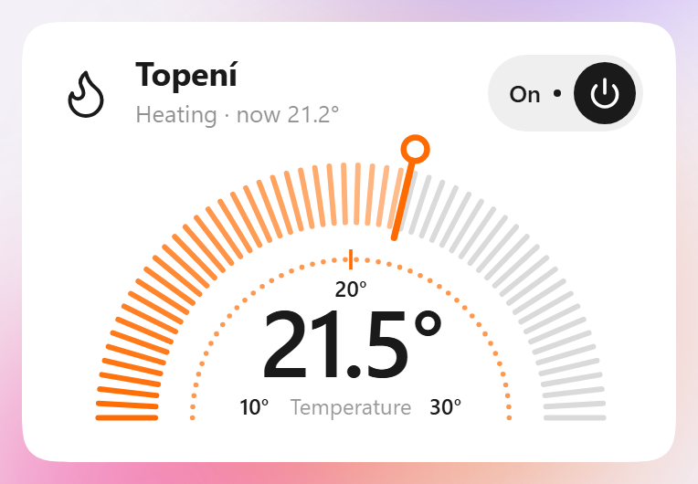
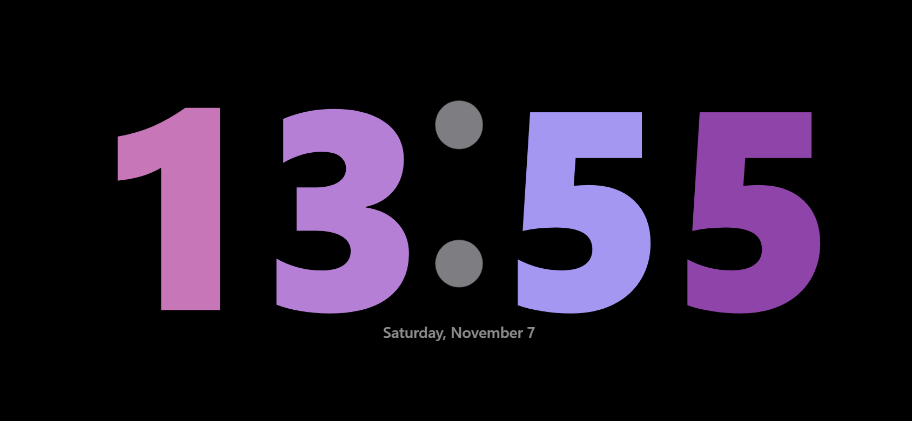
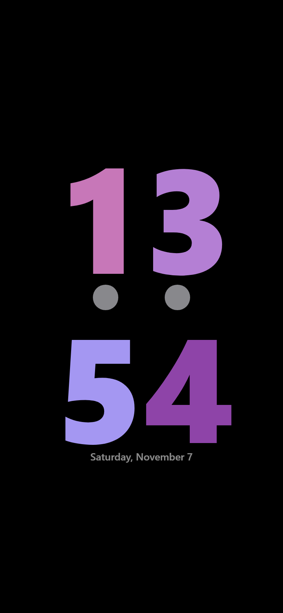

# dash

[](https://github.com/Lokkisanek/Guest-HA-Dashboard/actions/workflows/ci.yml)
[](https://github.com/Lokkisanek/Guest-HA-Dashboard/actions/workflows/validate.yml)
[](LICENSE)
[](https://hacs.xyz/docs/faq/custom_repositories/)

**dash** is an open-source, iOS-style dashboard for Home Assistant, built for wall-mounted phones, MagSafe stands and guests. You design it in a Home Assistant sidebar panel with a live iPhone preview. The phone runs it as a PWA.

- Control-Center-style grid with lights, switches, covers, climate and media; drag to reorder, pull the corner to resize.
- Liquid-glass dock with up to 6 pages, plus unlimited pages.
- Media player in several styles, with Spotify, Apple Music and YouTube Music (via Music Assistant) and Chromecast output switching.
- StandBy: after a period of inactivity the phone shows a big clock (portrait and landscape) or a slowly fading photo frame.
- Guest Wi-Fi card with a QR code, a weather and greeting header, light and dark mode, Czech and English.
- A playful `hello.dash` intro on first setup.
- **Guest passes** (Přístupy pro hosty): give a guest or a wall tablet a QR code that unlocks only the devices of one room, within limits (e.g. heating 18–25 °C) and only until check-out. Enforced by the integration on the server; the guest never gets a Home Assistant account or token.

**Demo:**: [demo URL](https://dash.matyas.online/) best experience on mobile with add to homescreen option

## Screenshots

<p>
  
  
  
</p>
<p>
  
  
</p>
<p>
  
  
</p>

Screenshots come from the demo build (`npm run screenshots`).

```text
 Phone (PWA)                         Your Home Assistant
┌──────────────────────┐  OAuth +   ┌──────────────────────────────┐
│ dash                 │ WebSocket  │ dash integration (HACS)      │
│ dash.matyas.online/  │ ─────────► │ • sidebar config panel       │
│   <your-ha-host>     │  direct    │ • config + photos stored     │
└──────────────────────┘            │   in /config                 │
                                    └──────────────────────────────┘
```

The page is static. Your browser talks to your Home Assistant directly. The dash server never receives your tokens, entity states, Wi-Fi password or photos. In hosted mode you still trust the code it delivers to your browser; self-hosting removes that. Details in [docs/SECURITY.md](docs/SECURITY.md).

## Two ways to run it

| | Hosted (free) | Self-hosted |
|---|---|---|
| URL | `https://dash.matyas.online/<your-ha-host>` | your own domain / LAN |
| Setup | none | Docker, port 86 |
| Requirement | HA reachable over **public HTTPS** | HA reachable from the phone |
| Who sees your data | your browser and your HA; the host serves the code but never receives your data | you |

Pick the mode in the panel under **General → Dashboard**. Hosted mode shows your personal link with Copy and Open buttons.

## Install

### 1. Home Assistant integration (HACS)

1. HACS → Integrations → ⋮ → **Custom repositories**.
2. Add `https://github.com/Lokkisanek/Guest-HA-Dashboard` with category **Integration**.
3. Install **dash** and restart Home Assistant.
4. Go to Settings → Devices & services → **Add integration** → **dash**.
5. Open **dash** in the sidebar, build your pages and press **Save**.

### 2. Open the dashboard on the phone

- **Hosted:** open the link from the panel, e.g. `https://dash.matyas.online/home.example.com`. Then sign in with your Home Assistant account and "Add to Home Screen".
- **Self-hosted:** see [docs/SELF_HOSTING.md](docs/SELF_HOSTING.md).

**For guests, use a guest pass**, not a Home Assistant account: in the panel open **Hosté**, create a room profile, then **Vytvořit přístup** and print or show the QR code. Signing in with Home Assistant (owner mode) gives full, unrestricted access, because Home Assistant has no per-entity permissions for users. See [Owner mode and guest passes](docs/SECURITY.md#owner-mode-and-guest-passes).

## Documentation

- [Configuration](docs/CONFIGURATION.md): pages, tile styles, dock, media, StandBy, photos.
- [Self-hosting](docs/SELF_HOSTING.md): Docker, Coolify, nginx, reverse proxies.
- [Security & privacy](docs/SECURITY.md): what is stored where, what the host can and can't see, owner mode vs. guest passes, logging.
- [Guest passes](docs/GUEST_PASSES.md): design, threat model and protocol.
- [Releasing](docs/RELEASING.md): version bump, changelog, tag, GitHub Release.
- [Changelog](CHANGELOG.md)

## Development

```bash
cp .env.example .env      # VITE_HA_URL=mock → demo data without Home Assistant
npm install
npm run dev               # PWA on http://localhost:5173
npm run build
```

Other scripts:

- `npm run check:versions`: the version in `package.json`, `manifest.json` and `const.py` must match.
- `npm run screenshots`: rebuilds `docs/img/*.png` from the demo build (needs `npx playwright install chromium` once).
- `npm run brand`: renders the integration icon (`custom_components/guest_ha_dashboard/brand/`) from `public/favicon.svg`.
- `node scripts/smoke.mjs`: smoke test against a running mock preview (see `.github/workflows/ci.yml`).
- `pytest`: integration tests (`pip install -r requirements_test.txt`; Linux/macOS, Python 3.14). `pytest tests/pure -p no:homeassistant` runs the policy tests anywhere, also on Windows.

Useful URL flags:

- `?standby=1` forces StandBy.
- `?lang=en` or `?lang=cs` forces the UI language.
- Demo build only: `?guest=1` shows the restricted guest dashboard, `?guest=ended` the ended-pass screen, `#pair=XXXX-XXXX-XXXX` the pairing screen.
- `?glass=lens` forces the WebKit liquid-glass path in Chrome.

The integration lives in `custom_components/guest_ha_dashboard/`. The panel is a single web component (`www/panel.js`) with no build step.

## Stack

Vue 3 · Vite · Tailwind 4 · daisyUI 5 · home-assistant-js-websocket · nginx · Home Assistant custom integration.

## License

dash is licensed under the GNU Affero General Public License v3.0 or later (see [LICENSE](LICENSE)).

In plain words: you can use, change and share dash for free, including commercially. If you modify dash and let others use it over a network, you must offer them your modified source under the same license.

Commercial use (e.g. hotels, rental companies or businesses that do not want to publish their changes) needs a separate commercial license, see [COMMERCIAL.md](COMMERCIAL.md).

Contributions: see [CONTRIBUTING.md](CONTRIBUTING.md).
